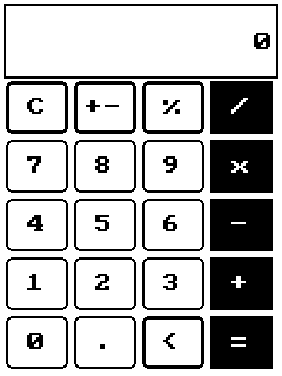

# calculator

[](LICENSE)
[](https://github.com/choco-technologies/calculator/actions/workflows/ci.yml)

A pocket calculator for dmodOS - and a model application of the launcher: it has an **icon**, a **view**, and it lives in a **rent of the
screen** that the phone's launcher (phoneui) gives it, so the status bar and the dock stay where they are.



## What it shows

| What | Where |
|------|-------|
| the icon (the default one, and one for the 1-bit e-paper of the T-Deck Pro) | `icons/` - `DMOD_ICON_PATH` in `CMakeLists.txt`, `icon=` in `calculator.dmr` |
| the view, drawn by libdmview into whatever size it is given | `views/calculator.dmvs` - generated by `scripts/gen_view.py` |
| the arithmetic, without any floating point, tested on a PC | `src/calc.c`, `tests/calculator_test.c` |
| the application: claims the rent, sets two properties, takes the keys | `src/calculator.c` |

## Using it

The launcher starts it with `calculator --display <rent>`. By hand: `calculator [--display NAME] [<view>]` - `NAME` is a display or the rent of
one (without it, the first display). Keys: the screen's keys (a touch), or the keyboard: `0-9 . ,`, `+ - * /`, `=` or Enter, `%`, Backspace,
`C`. The application ends when the owner takes the rent back (the user went to another page).

Numbers have up to 11 digits and 6 decimal places, exact (`0.1 + 0.2 = 0.3`); what does not fit, and a division by zero, is `Error`.
Operations are done one at a time, as on a pocket calculator (`2 + 3 x 4 =` is 20). `%` is a percent of what is shown (`200 + 10 % =` is 220).

## Building

```bash
cmake -S . -B build
cmake --build build
ctest --test-dir build        # the arithmetic
```

It needs the `libdmview` module (0.20 or newer: the screen rent), which `dmf-get` installs. See [docs/](docs/) for the usage.

CMake uses an installed `dmod-dev` SDK; without one it fetches dmod's `develop` branch. `-DDMOD_DIR=/path/to/dmod` selects a local checkout.

## Changing the view

The keys are a grid of boxes, each with its own handler, so the view is generated: change `ROWS` in `scripts/gen_view.py` and run

```bash
python3 scripts/gen_view.py > views/calculator.dmvs
```

## License

MIT
